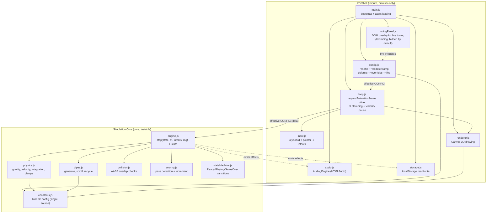
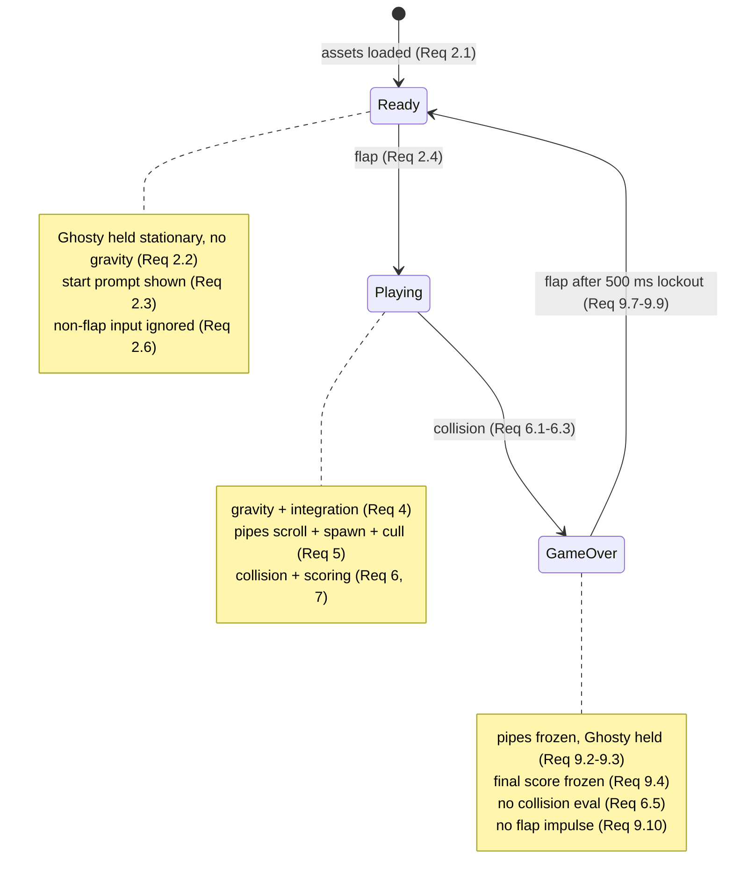

# Design Document: Flappy Kiro

## Overview

Flappy Kiro is a dependency-free, browser-based endless scroller built with **HTML5 Canvas and vanilla JavaScript (ES modules)**. The player guides "Ghosty" through scrolling green pipes; each flap applies an upward impulse and gravity pulls Ghosty down continuously. The game runs directly in a browser by opening a single `index.html` file — no build step, bundler, transpiler, or runtime dependency is required.

### Why this stack

The requirements describe a small, self-contained retro game with pixel-art rendering, per-frame physics, and local-storage persistence. These map directly onto primitives the browser already provides:

- **Canvas 2D** gives pixel-level control, hard non-antialiased edges (`imageSmoothingEnabled = false`, Req 1.5), layered background/parallax drawing (Req 1.6–1.10), and a single `requestAnimationFrame` loop (Req 10.1–10.3).
- **Vanilla ES modules** let us split *pure game logic* from *rendering and DOM* so the logic can be unit- and property-tested in Node without a browser or a DOM shim. This separation is the central design decision — see [Architecture](#architecture).
- **`localStorage`** satisfies persistence (Req 8) with synchronous, try/catch-guarded access.

Introducing a framework or bundler would add tooling and dependencies the game does not need and would make the "open the HTML file and play" experience harder. The tradeoff is that we write a small amount of our own loop/render plumbing, which is straightforward for a game of this size.

### Scope

This design covers **the initial version, Requirements 1–10**. Requirements 11–13 (Ghosty color customization, flair customization, best-distance ground marker) are explicitly **out of scope** and are **not designed here**. The architecture does, however, reserve concrete extension points so those can be added later without restructuring; these are called out inline and summarized in [Extension Points for Future Enhancements](#extension-points-for-future-enhancements).

---

## Architecture

The core architectural decision is a strict separation between a **pure simulation core** and the **impure I/O shell** (rendering, input events, audio, storage, timing). The simulation core is a set of pure functions over plain data: given a world state and inputs, it returns a new world state. It never touches the DOM, `Canvas`, `Date.now`, `Math.random` (directly), `localStorage`, or audio. This is what makes the physics, scoring, pipe recycling, and collision logic unit- and property-testable.

### Layers



`config.js` and `tuningPanel.js` are a **developer-facing tuning convenience**, not a new game requirement. They sit entirely in the shell. `constants.js` remains the single source of **defaults**; `config.js` resolves those defaults plus any overrides into a single frozen **effective CONFIG** of the same shape, and the loop passes that object into `engine.step()` as plain data each frame. The pure core never reads URL params, `window` globals, or the DOM — it only consumes the config it is handed. With no overrides supplied and the panel untouched, the effective CONFIG is value-equal to `constants.js`, so a default configuration behaves exactly as specified by Requirements 1–10 (see [Configuration and Tuning](#configuration-and-tuning)).

### Data flow per frame

1. `loop.js` receives a timestamp from `requestAnimationFrame`, computes `dt` (seconds), and **clamps** it to the range [0.016 s, 0.100 s] (Req 10.3). While the tab is hidden the loop does not accumulate time (Req 10.4).
2. `input.js` has already translated raw browser events into a small, debounced set of **intents** (e.g. `flap`, `pointerFlap{x,y}`) collected since the last frame.
3. `loop.js` reads the current **effective CONFIG** from `config.js` and calls `engine.step(state, dt, intents, rng, config)`. The engine runs the state machine, physics, pipe updates, collision, and scoring using the config values it is handed, and returns a **new state** plus a list of **effects** (`playSound`, `persistHighScore`). The config is plain, already-clamped data; the core never reads URL params, `window`, or the DOM.
4. `loop.js` hands the effects to the shell (`audio.js`, `storage.js`) and passes the new state to `renderer.js` to draw the frame.

When a developer edits a value in the tuning panel, `tuningPanel.js` updates the live-overrides layer and `config.js` **re-resolves** (and re-clamps) the effective CONFIG. The loop reads this refreshed config on the next frame, so edits take effect immediately without restructuring — the only change is that the loop sources its config from `config.js` rather than importing `constants.js` directly. With no overrides and the panel untouched, the effective CONFIG equals the defaults, so the per-frame behavior is identical to the pre-tuning design. (The effective CONFIG may equivalently be carried on the `World`/state rather than passed as a separate argument; either way it reaches the core as data.)

The engine returning *effects as data* (rather than calling audio/storage itself) keeps it pure: tests assert on the returned effect list instead of mocking side effects. Effects are the only coupling between core and shell beyond state and config.

### Module responsibilities

| Module | Layer | Responsibility |
|--------|-------|----------------|
| `constants.js` | core | Single source of all **default** values (Req 1–10 numeric constants); the defaults layer the effective config is built from. |
| `physics.js` | core | Apply gravity, integrate position, clamp velocity, apply/clamp flap impulse (Req 4). |
| `pipes.js` | core | Generate pipe pairs at fixed spacing, scroll, cull/recycle off-screen pipes (Req 5). |
| `collision.js` | core | AABB overlap tests of Ghosty vs pipes, ground, ceiling (Req 6). |
| `scoring.js` | core | Detect gap pass, increment once per pipe (Req 7). |
| `stateMachine.js` | core | Ready ↔ Playing ↔ GameOver transitions and timers (Req 2, 6, 9). |
| `engine.js` | core | Orchestrate the above into `step()`, produce effects. |
| `loop.js` | shell | rAF driver, dt clamp, visibility pause (Req 10). |
| `input.js` | shell | Keyboard/pointer → intents, auto-repeat suppression, bounds check (Req 3). |
| `renderer.js` | shell | Draw background, clouds/parallax, pipes, ground, Ghosty, HUD (Req 1, 7.3–7.4, 9.5). |
| `audio.js` | shell | Play `jump.wav` / `game_over.wav` (Req 3.5, 9.1). |
| `storage.js` | shell | Read/validate/write High_Score in localStorage (Req 8). |
| `config.js` | shell | Resolve the effective CONFIG by merging defaults ← global object ← URL params ← live panel overrides; validate/clamp every value to its locked value or allowed range; return a frozen CONFIG of the same shape. Developer tooling — does not change default-config behavior. |
| `tuningPanel.js` | shell | Optional DOM overlay with inputs/sliders for the freely-tunable parameters; hidden by default, toggled by a key/button; feeds edits into the live-overrides layer and triggers a config re-resolve. Developer tooling. |
| `main.js` | shell | Asset loading, wiring, fallback sprite (Req 1.4, 2.1); builds the effective CONFIG via `config.js` and wires `tuningPanel.js`. |

---

## Components and Interfaces

Interfaces are written as JSDoc-style type signatures. The core modules operate on plain data structures (see [Data Models](#data-models)).

### Simulation core

```js
// engine.js
/**
 * Pure step function. Advances the world by dt seconds given player intents.
 * @param {World} state
 * @param {number} dt           elapsed seconds, already clamped by the loop
 * @param {Intents} intents     intents collected since last frame
 * @param {() => number} rng    returns a float in [0,1); injected for determinism
 * @param {Config} config       the frozen effective CONFIG (already validated/clamped by config.js)
 * @returns {{ state: World, effects: Effect[] }}
 */
export function step(state, dt, intents, rng, config) { /* ... */ }

/** @returns {World} a fresh Ready-state world sized to the given play area. */
export function createWorld(dims, highScore) { /* ... */ }
```

```js
// physics.js
/** @returns {Ghosty} with gravity applied and velocity clamped to maxFallSpeed. */
export function applyGravity(ghosty, dt) { /* ... */ }

/** @returns {Ghosty} with position integrated from velocity over dt. */
export function integrate(ghosty, dt) { /* ... */ }

/** @returns {Ghosty} with vertical velocity set to the clamped flap impulse. */
export function applyFlap(ghosty) { /* ... */ }

/** Clamp a requested impulse into [FLAP_IMPULSE_MIN, FLAP_IMPULSE_MAX]. */
export function clampImpulse(value) { /* ... */ }
```

```js
// pipes.js
/** @returns {PipePair} a new pair whose gap center is chosen via rng within legal bounds. */
export function generatePipe(dims, rng, leftEdgeX) { /* ... */ }

/** @returns {PipePair[]} scrolled left by speed*dt; may append a new pair at fixed spacing. */
export function updatePipes(pipes, dims, dt, rng) { /* ... */ }

/** @returns {PipePair[]} with pairs fully past the left edge removed. */
export function cullPipes(pipes) { /* ... */ }
```

```js
// collision.js
/** @returns {boolean} true if a and b axis-aligned boxes overlap or touch. */
export function aabbOverlap(a, b) { /* ... */ }

/** @returns {boolean} true if Ghosty hits any pipe, the ground, or the ceiling. */
export function hasCollision(ghosty, pipes, dims) { /* ... */ }
```

```js
// scoring.js
/**
 * Increment score for each pipe whose trailing edge Ghosty has just crossed.
 * Mutates no input; returns new score and updated pipe `scored` flags.
 * @returns {{ score: number, pipes: PipePair[] }}
 */
export function updateScore(score, ghosty, pipes) { /* ... */ }
```

```js
// stateMachine.js
export const States = Object.freeze({ READY: 'ready', PLAYING: 'playing', GAME_OVER: 'gameOver' });
/** @returns {World} applying any valid transition for the current state/intents/timers. */
export function advanceState(state, intents, dt) { /* ... */ }
```

### I/O shell

```js
// input.js
/**
 * Attaches listeners and exposes an intent buffer drained once per frame.
 * - Spacebar keydown with event.repeat === true is ignored (Req 3.2).
 * - Pointer events outside the canvas bounds are ignored (Req 3.4).
 */
export function createInput(canvas) {
  return { /** @returns {Intents} and clears the buffer */ drain() {} };
}
```

```js
// loop.js
/** Drives the frame loop; owns dt clamping and visibilitychange pause (Req 10). */
export function startLoop({ getState, setState, input, render, audio, storage }) { /* ... */ }
```

```js
// renderer.js
/** Draw one frame of the given world to the 2D context. Never mutates state. */
export function render(ctx, world, assets) { /* ... */ }
```

```js
// audio.js
/** @returns {{ play(name: 'jump'|'gameOver'): void }} wrapping HTMLAudioElement. */
export function createAudio(assets) { /* ... */ }
```

```js
// storage.js
/** @returns {number} a valid non-negative integer high score, or 0 (Req 8.4–8.6). */
export function loadHighScore() { /* ... */ }
/** Persist; swallow failures and let the caller keep the in-memory value (Req 8.3). */
export function saveHighScore(value) { /* ... */ }
```

```js
// config.js  (developer tooling — never alters default-config behavior)
/** @typedef {typeof import('./constants.js').CONFIG} Config */

/**
 * Resolve the effective CONFIG by merging layers in priority order
 * (later overrides earlier): defaults ← window.FLAPPY_CONFIG ← URL query params.
 * Every value is validated and clamped: locked invariant fields are forced to
 * the base value; range-valued fields (including the configurable gameplay
 * parameters) are clamped into their allowed range. Unknown keys and malformed
 * values are ignored. An optional `difficulty` source selects the base config.
 * @param {object} [sources]  { global?: object, search?: string, difficulty?: string }
 * @returns {Config} a frozen CONFIG of the same shape constants.js exports
 */
export function resolveConfig(sources) { /* ... */ }

/**
 * Re-resolve including the live-overrides layer applied last:
 * defaults ← global ← URL ← liveOverrides. Same clamping discipline.
 * @param {object} liveOverrides  partial, raw values from the tuning panel
 * @returns {Config} a new frozen CONFIG
 */
export function withLiveOverrides(liveOverrides) { /* ... */ }

/** @returns {Config} clamp/lock a raw partial onto a base config. Pure, reusable by tests. */
export function clampConfig(base, rawPartial) { /* ... */ }
```

```js
// tuningPanel.js  (developer tooling — hidden by default)
/**
 * Mount a hidden DOM overlay with labeled inputs/sliders for the freely-tunable
 * parameters (each label states its allowed range). Toggled by a key (backtick `)
 * or a "Toggle tuning panel" button. Editing a field calls onChange with the raw
 * partial; the caller re-resolves via config.js (which clamps) and the panel then
 * reflects the clamped effective value. Includes a "reset to defaults" action.
 * @param {{ onChange: (raw: object) => Config, defaults: Config }} opts
 * @returns {{ toggle(): void, destroy(): void }}
 */
export function createTuningPanel(opts) { /* ... */ }
```

---

## Data Models

All core state lives in a single immutable-by-convention `World` object. The engine returns new objects rather than mutating in place, which keeps `step()` referentially transparent for property testing.

```js
/** @typedef {{ width: number, height: number, groundHeight: number }} Dims */

/** @typedef {Object} Ghosty
 *  @property {number} x            fixed horizontal position (constant during play)
 *  @property {number} y            vertical center position
 *  @property {number} vy           vertical velocity (px/s, positive = downward)
 *  @property {number} w            sprite width
 *  @property {number} h            sprite height
 */

/** @typedef {Object} PipePair
 *  @property {number} id           monotonic id, used to dedupe scoring
 *  @property {number} x            left edge x (scrolls down over time)
 *  @property {number} width        pipe width
 *  @property {number} gapTop       y of the top of the gap
 *  @property {number} gapBottom    y of the bottom of the gap
 *  @property {boolean} scored      whether this pair has already awarded a point
 */

/** @typedef {Object} Cloud
 *  @property {number} x
 *  @property {number} y
 *  @property {number} layer        depth layer index (0 = farthest)
 *  @property {number} speedFactor  fraction of pipe speed, < 1
 *  @property {number} opacity      [0.2, 0.8]
 */

/** @typedef {Object} World
 *  @property {'ready'|'playing'|'gameOver'} status
 *  @property {Dims} dims
 *  @property {Ghosty} ghosty
 *  @property {PipePair[]} pipes
 *  @property {Cloud[]} clouds
 *  @property {number} score
 *  @property {number} highScore
 *  @property {number} finalScore       frozen at game over (Req 9.4)
 *  @property {number} distanceSincePipe horizontal distance accumulated toward next spawn
 *  @property {number} gameOverElapsed   ms since entering GameOver (restart lockout, Req 9.6)
 *  @property {number} nextPipeId
 */

/** @typedef {Object} Intents
 *  @property {boolean} flap            a discrete, de-duplicated flap this frame
 */

/** @typedef {{ type: 'playSound', name: 'jump'|'gameOver' }
 *          | { type: 'persistHighScore', value: number }} Effect */
```

### Tunable constants (the DEFAULTS layer)

All numeric tuning lives in `constants.js`, which is the **defaults layer** of the configuration system. Values are chosen within the ranges the requirements allow; where a requirement fixes a value exactly, that value is used. Lengths that scale with the play area are expressed as factors and resolved against `Dims` at runtime. The **effective CONFIG** produced by `config.js` has the exact same shape as this object; the core reads the effective CONFIG and, with no overrides, it is value-equal to the defaults below.

```js
// constants.js
export const CONFIG = Object.freeze({
  // Scene (Req 1)
  GROUND_HEIGHT_FACTOR: 0.12,     // Req 1.2: within [0.05, 0.20]
  GHOSTY_HEIGHT_FACTOR: 0.10,     // Req 1.3: within [0.05, 0.15]
  CLOUD_OPACITY_MIN: 0.2,         // Req 1.7
  CLOUD_OPACITY_MAX: 0.8,         // Req 1.7
  CLOUD_MIN_SPEED: 10,            // Req 1.8: px/s > 0, floor independent of pipe speed
  CLOUD_LAYER_FACTORS: [0.2, 0.4],// Req 1.9: farther layer slower than nearer

  // Physics (Req 4)
  GRAVITY: 1600,                  // Req 4.1: within [800, 2400] px/s^2
  MAX_FALL_SPEED: 1200,           // Req 4.3: px/s cap on downward velocity
  FLAP_IMPULSE: 480,              // Req 4.4: within [300, 700] px/s (applied as -480 vy)
  FLAP_IMPULSE_MIN: 300,          // Req 4.4 clamp lower bound
  FLAP_IMPULSE_MAX: 700,          // Req 4.4 clamp upper bound

  // Pipes (Req 5)
  PIPE_SPEED_FACTOR: 0.35,        // Req 5.1: play-area widths per second
  PIPE_SPACING_FACTOR: 0.5,       // Req 5.2: * play-area width
  PIPE_GAP_MARGIN_FACTOR: 0.1,    // Req 5.3: * play-area height, top & bottom
  PIPE_GAP_GHOSTY_MULTIPLE: 2.5,  // Req 5.4: gap = 2.5 * Ghosty height
  PIPE_WIDTH_FACTOR: 0.12,        // pipe rectangle width, * play-area width

  // Loop / timing (Req 10)
  TARGET_FPS: 60,                 // Req 10.1
  DT_MIN: 0.016,                  // Req 10.3: clamp lower bound (seconds)
  DT_MAX: 0.100,                  // Req 10.3: clamp upper bound (seconds)

  // Game over (Req 9)
  RESTART_LOCKOUT_MS: 500,        // Req 9.6/9.7: ignore flaps for first 500 ms

  // Ready state
  GHOSTY_START_Y_FACTOR: 0.4,     // Req 2.2: fixed vertical start, upper-middle

  // Persistence (Req 8)
  HIGH_SCORE_KEY: 'flappyKiro.highScore',
});
```

Derived runtime values (resolved from factors and `Dims`):
- `pipeSpeed = PIPE_SPEED_FACTOR * dims.width` (px/s).
- `cloudLayerSpeed[i] = max(CLOUD_MIN_SPEED, CLOUD_LAYER_FACTORS[i] * pipeSpeed)` — guarantees clouds move even at low pipe speed (Req 1.8) while keeping each layer slower than the pipes and farther layers slower than nearer (Req 1.9).
- `pipeGap = PIPE_GAP_GHOSTY_MULTIPLE * ghosty.h`.

#### Locked vs tunable fields

The effective CONFIG has two classes of field, enforced by `config.js` (full rules in [Configuration and Tuning](#configuration-and-tuning)):

> **Update (configurability):** the game is now intentionally configurable, so the formerly requirement-fixed *gameplay* parameters (pipe speed, pipe spacing, gap margin, gap multiple, max fall speed) are no longer locked — they are tunable within sensible ranges (see below). The default values are unchanged, so a default-config run still behaves exactly as Requirements 1–10 specify; only the ability to deliberately change them has been added. Only true correctness/safety invariants remain locked.

- **Locked (invariants)** — values that are correctness/safety guards rather than game-feel knobs. If an override or panel attempts to set them, `config.js` forces them back to the base value: `DT_MIN` = 0.016 / `DT_MAX` = 0.100 (the frame-time clamp that prevents a stall or backgrounded tab from teleporting Ghosty through a wall, Req 10.3), `CLOUD_OPACITY_MIN` = 0.2 / `CLOUD_OPACITY_MAX` = 0.8 (sky stays visible, Req 1.7), `RESTART_LOCKOUT_MS` = 500 (Req 9.6).
- **Tunable within range** — freely adjustable, clamped to their bounds. The original ranged fields: `GRAVITY` ∈ [800, 2400] (Req 4.1), `FLAP_IMPULSE` ∈ [300, 700] (Req 4.4), `GROUND_HEIGHT_FACTOR` ∈ [0.05, 0.20] (Req 1.2), `GHOSTY_HEIGHT_FACTOR` ∈ [0.05, 0.15] (Req 1.3), `CLOUD_MIN_SPEED` > 0 (Req 1.8), `CLOUD_LAYER_FACTORS` (positive, ascending, each < 1, Req 1.9). Newly tunable gameplay fields (defaults still match Req 5 / 4.3): `PIPE_SPEED_FACTOR` ∈ [0.1, 0.8] (default 0.35), `PIPE_SPACING_FACTOR` ∈ [0.3, 1.0] (default 0.5), `PIPE_GAP_MARGIN_FACTOR` ∈ [0.05, 0.25] (default 0.1), `PIPE_GAP_GHOSTY_MULTIPLE` ∈ [1.5, 4.0] (default 2.5), `MAX_FALL_SPEED` ∈ [600, 1800] (default 1200).
- **Difficulty presets** — Easy / Normal / Hard are a *sanctioned configuration layer* (`src/core/difficulty.js`) that sets the gameplay fields above to produce a named base config. Normal equals the defaults exactly. Difficulty is the base; dev overrides (global/URL/live panel) layer on top and are still clamped. Selectable in-game or via `?difficulty=easy|normal|hard`.

---

## Game Loop and State Machine Design

### State machine (Req 2, 6, 9)



Transition handling inside `step()`:

- **Ready → Playing** (Req 2.4, 2.5, 4.5): on a `flap` intent, set `ghosty.vy = 0`, clear the start prompt (a render concern driven by `status`), reset `score = 0` (Req 7.1), and switch to Playing. Non-flap input produces no intent, so Ready simply persists (Req 2.6).
- **Playing → GameOver** (Req 6): after physics and pipe updates, evaluate `hasCollision`. A single boolean OR over all conditions guarantees exactly one transition even if multiple conditions hold in the same frame (Req 6.4). On transition: freeze `finalScore` from `score` (Req 9.4), update `highScore` if `score > highScore` (Req 8.1) and emit a `persistHighScore` effect (Req 8.2), emit a `playSound: gameOver` effect (Req 9.1), and set `gameOverElapsed = 0`.
- **GameOver**: no physics, no scrolling, no collision evaluation (Req 6.5, 9.2, 9.3). `gameOverElapsed` accumulates `dt`. Flaps are ignored while `gameOverElapsed < RESTART_LOCKOUT_MS` (Req 9.6) and never produce an impulse (Req 9.10). Once the lockout passes, a flap resets Ghosty to the start position, clears all pipes, and transitions to Ready (Req 9.7–9.9).

### Frame loop (Req 10)

`loop.js` owns timing so the core stays free of wall-clock calls:

- Uses `requestAnimationFrame`, targeting 60 FPS (Req 10.1). The browser throttles to display cadence; we rely on `dt` integration so motion is frame-rate independent (Req 10.3).
- Computes `dt` from successive timestamps and clamps to `[DT_MIN, DT_MAX]` before calling `step()`. Clamping the upper bound prevents a long stall from teleporting Ghosty/pipes; clamping the lower bound keeps very fast frames stable (Req 10.3).
- **Visibility pause (Req 10.4):** a `visibilitychange` listener. When the document becomes hidden, the loop stops advancing the simulation; on becoming visible again it resets its `lastTimestamp` to "now" so the hidden interval is discarded rather than applied as one huge `dt`. Rendering of the frozen frame may continue, but physics does not advance.

---

## Rendering Approach

`renderer.js` draws the world top-to-bottom each frame; it reads `world` and never mutates it. Draw order establishes depth (Req 1.6):

1. **Sky-blue fill** over the whole canvas (Req 1.1).
2. **Clouds**, farther layers first, each drawn with `globalAlpha` in [0.2, 0.8] so the sky shows through (Req 1.6, 1.7). Cloud x positions come from the world; the renderer only draws.
3. **Pipes** as green rectangles. `ctx.imageSmoothingEnabled = false` and integer-aligned coordinates give hard pixel edges (Req 1.5). Only pairs at least partially within horizontal bounds are drawn (Req 10.2).
4. **Ground** strip along the bottom, full width, `GROUND_HEIGHT_FACTOR` tall (Req 1.2).
5. **Ghosty**, drawn from the `ghosty.png` image if it loaded, otherwise a solid placeholder rectangle of identical bounds (Req 1.4).
6. **HUD / Score_Display**: current score and high score as integers (Req 7.3, 7.4); because rendering happens every frame right after `step()`, the shown score matches within one frame of any change (Req 7.3).
7. **State overlays**: the Ready start prompt (Req 2.3) or the GameOver message with final score and restart prompt (Req 9.5), selected by `world.status`.

Cloud motion and recycling (Req 1.8–1.10) are computed in the core alongside pipe updates (clouds live in `World`), so they are testable and stay in lock-step with the paused/clamped `dt`. A cloud scrolled fully past the left edge is repositioned to the right with a new y/opacity (Req 1.10).

---

## Input Handling

`input.js` converts raw browser events into a minimal `Intents` buffer drained once per frame. Keeping translation in the shell lets the core treat input as plain booleans.

- **Spacebar** (Req 3.1, 3.2): on `keydown` for `Space`/`" "`, enqueue a flap **only if `event.repeat === false`**, which discards OS auto-repeat. A pressed flag plus listening for `keyup` is an additional guard so a held key yields exactly one flap until released and pressed again.
- **Pointer** (Req 3.3, 3.4): on `pointerdown`/`click`/`touchstart`, map the event to canvas coordinates and enqueue a flap **only if the point lies within the canvas (Play_Area) bounds**; points outside are ignored.
- The buffer collapses multiple same-frame flaps into a single `flap: true` intent, so the engine applies at most one impulse per frame; audio effects are emitted by the engine only when an impulse is actually applied (Req 3.5), guaranteeing one `jump.wav` per flap.
- During Ready, a flap starts the game; during GameOver, a flap is consumed by the restart logic (never an impulse, Req 9.10). The same intent is interpreted differently by the state machine, so input code needs no knowledge of game state.

---

## Audio

`audio.js` wraps the two provided assets as `HTMLAudioElement`s and exposes `play('jump' | 'gameOver')`. The engine never calls it directly; instead it emits `{ type: 'playSound', name }` effects which the loop forwards. This keeps "one sound per flap" (Req 3.5) and "one non-looping game-over sound" (Req 9.1) decidable by inspecting the effect list in tests.

- Each sound is played with `loop = false`; to allow rapid re-triggering of `jump.wav`, the element's `currentTime` is reset to 0 before `play()` (or a small pool of clones is used) so overlapping flaps each produce an audible sound.
- `game_over.wav` is played exactly once on entry to GameOver because the transition that emits the effect happens exactly once (Req 6.4, 9.1).
- Autoplay policies: audio is created/unlocked on the first user gesture (the first flap), which naturally coincides with Ready → Playing.

---

## Persistence (Local Storage)

`storage.js` is the only module that touches `localStorage`. The engine expresses persistence as a `persistHighScore` effect; the shell performs the write.

- **Load (Req 8.4–8.6):** `loadHighScore()` reads `CONFIG.HIGH_SCORE_KEY`. It returns a validated value: if the key is missing (Req 8.5), or the stored string is non-numeric, negative, or not an integer (Req 8.6), it returns `0`. Validation parses with `Number()` and checks `Number.isInteger(n) && n >= 0`.
- **Save (Req 8.1–8.3):** when the engine raises `highScore` at game over, it emits `persistHighScore`. `saveHighScore(value)` wraps the write in `try/catch`; on failure (quota, disabled storage, private mode) it silently returns and the in-memory `highScore` is kept for the rest of the session so gameplay is uninterrupted (Req 8.3). The write happens immediately on game over, well within the 1-second bound (Req 8.2).

---

## Configuration and Tuning

> **This is a developer-facing convenience, not a game requirement.** It adds no new functional behavior and traces to **no** requirement in Requirements 1–13; it is a non-functional / developer-tooling concern layered on top of the existing constants to make experimentation easy. The hard invariant: **with no overrides supplied and the tuning panel untouched, the effective CONFIG is value-equal to `constants.js`, so the Game behaves exactly as specified by Requirements 1–10.** The pure simulation core stays pure — it never reads URL params, `window` globals, or the DOM; it only consumes the already-validated config it is handed as data. The feature preserves the dependency-free, no-build philosophy: `config.js` and `tuningPanel.js` are plain ES modules and the panel is a DOM overlay, shipping nothing new to the browser.

### Three-layer model and precedence

The effective CONFIG is resolved by merging three layers, where **later layers override earlier ones**:

1. **Defaults** — the existing `CONFIG` in `constants.js`, used unchanged as the base.
2. **Startup overrides** (applied in this sub-order):
   a. **Global config object** — `window.FLAPPY_CONFIG`, a partial object merged over the defaults.
   b. **URL query parameters** — e.g. `?gravity=2000&pipeSpeed=0.4`, parsed and merged over the global object (so URL wins over the global object at startup).
3. **Live overrides** — values changed via the in-game tuning panel at runtime, applied last, on top of everything above.

So the resolution order is: `defaults ← window.FLAPPY_CONFIG ← URL params ← live panel`. `config.js` performs a shallow merge of known keys only, then validates and clamps the result.

### Validation and clamping rules

`config.js` **never applies a raw override**. Every candidate value passes through the same clamping discipline already used for flap impulse (Req 4.4) and dt (Req 10.3):

- **Locked (invariant) fields** are forced back to the base value if an override targets them. These are the correctness/safety guards only: dt clamp [0.016, 0.100] (Req 10.3), cloud opacity [0.2, 0.8] (Req 1.7), restart lockout 500 ms (Req 9.6). Locking these guarantees an override can never produce a physically broken state (e.g. a huge dt that teleports Ghosty through a wall).
- **Tunable-within-range fields** are clamped to the nearest valid value in their range: gravity → [800, 2400], flap impulse → [300, 700], ground height factor → [0.05, 0.20], Ghosty height factor → [0.05, 0.15], cloud min speed → (0, ∞), cloud layer factors → positive/ascending/<1, and the now-configurable gameplay fields: pipe speed → [0.1, 0.8], pipe spacing → [0.3, 1.0], gap margin → [0.05, 0.25], gap multiple → [1.5, 4.0], max fall speed → [600, 1800]. Defaults are unchanged, so a default run matches Requirements 1–10; clamping ensures an override is always valid even though these fields are no longer locked.
- **Out-of-range or malformed values** (non-numeric, `NaN`, wrong type) are clamped to the nearest valid value, or ignored and left at the lower-priority value — never applied raw.
- **Unknown keys** (not present in the default shape) are ignored.

The result is returned as a **frozen** object (`Object.freeze`) of the same shape as `constants.js`, so `engine.js` / `physics.js` / `pipes.js` read it exactly as they read the defaults today — the only change is that they receive the config as data rather than importing the module directly.

### Override formats with examples

Global object (set before the game boots, e.g. in a `<script>` tag or the console):

```js
window.FLAPPY_CONFIG = {
  GRAVITY: 2000,            // clamped into [800, 2400]
  FLAP_IMPULSE: 520,        // clamped into [300, 700]
  GHOSTY_HEIGHT_FACTOR: 0.3 // out of range -> clamped to 0.15
};
```

URL query parameters (merged over the global object; friendly aliases map to CONFIG keys):

```
index.html?gravity=2000&flapImpulse=520&groundHeight=0.15
index.html?gravity=99999   -> clamped to 2400
index.html?pipeSpeed=0.4   -> applied (now tunable; clamped into [0.1, 0.8])
index.html?difficulty=hard -> selects the Hard preset as the config base
index.html?wobble=3        -> ignored (unknown key)
```

### Tuning panel behavior

`tuningPanel.js` mounts an **HTML/DOM overlay** (deliberately **not** drawn on the Canvas, so `renderer.js` stays free of UI widgets and remains a pure draw of the world):

- It exposes number inputs / sliders **only for the freely-tunable parameters**, each label stating its allowed range (e.g. "Gravity [800–2400]").
- It is **hidden by default** and toggled by a key (backtick `` ` ``) or a "Toggle tuning panel" button, so normal play is never affected.
- Editing a field writes into the **live-overrides layer** and asks `config.js` to re-resolve the effective CONFIG (which clamps). Because the loop reads config each frame and passes it into `step()` as data, the change takes effect on the **next frame** with no restructuring. The panel then displays the **clamped effective value**, so a value can never escape its range on screen.
- A **"reset to defaults"** action clears the live-overrides layer (and may clear startup overrides for the session), returning the effective CONFIG to the defaults.

---

## Error Handling

| Failure | Handling | Requirement |
|---------|----------|-------------|
| `ghosty.png` fails to load | Render a solid placeholder rectangle of the same bounds; keep rendering other elements. A `spriteLoaded` flag on `assets` drives the choice. | 1.4 |
| `localStorage` read invalid/missing | `loadHighScore()` returns `0` after validation. | 8.5, 8.6 |
| `localStorage` write throws | `saveHighScore()` catches, keeps in-memory value, continues. | 8.3 |
| Audio asset fails / autoplay blocked | `audio.play()` wraps the returned promise and swallows rejection; gameplay is unaffected. | 3.5, 9.1 (graceful) |
| Long frame / tab backgrounded | `dt` clamp caps a single step; visibility pause discards hidden time. | 10.3, 10.4 |
| Multiple collisions same frame | Single OR-ed condition → exactly one transition. | 6.4 |
| Malformed / out-of-range config override (global object or URL param) | `config.js` clamps to the nearest valid value, or ignores it and keeps the lower-priority value; never applied raw. Locked invariant fields are forced to the base value. | dev tooling (preserves invariants 1.7, 9.6, 10.3; defaults still match 1–10) |
| Unknown config key in override or URL | `config.js` ignores keys not present in the default shape. | dev tooling |
| Invalid tuning-panel input (empty, non-numeric, out of range) | `config.js` clamps on re-resolve; the panel reflects the clamped effective value so it can never escape range. | dev tooling |

The simulation core performs no I/O and therefore has no error paths; all error handling lives in the shell, which is the layer that can fail. The configuration rows above are developer-tooling safeguards: they ensure overrides cannot push the effective CONFIG outside the requirement-mandated values/ranges, so a default run and the Correctness Properties remain intact.

---

## Correctness Properties

*A property is a characteristic or behavior that should hold true across all valid executions of a system — essentially, a formal statement about what the system should do. Properties serve as the bridge between human-readable specifications and machine-verifiable correctness guarantees.*

These properties target the **pure simulation core**, which is where the testable, input-varying logic lives (physics, pipes, collision, scoring, state transitions, persistence validation). Each is implemented as a single property-based test over generated inputs. Rendering, timing cadence, and audio/DOM wiring are validated by example/integration tests in the [Testing Strategy](#testing-strategy) instead. The set below has been de-duplicated per the prework reflection (e.g. the three collision conditions are one property; the GameOver-frozen invariant covers Ready stillness too).

The property semantics are unchanged by the tuning feature. Where a property references a specific constant (e.g. 0.35 play-area widths/s, 1200 px/s, [300, 700]), that constant is sourced from the **effective CONFIG / defaults** the core is given, not read independently. Because `config.js` locks requirement-fixed values and clamps range-valued ones, the core always receives a valid config, so these properties continue to hold for any resolved configuration.

### Property 1: Cloud opacity stays semi-transparent

*For all* generated clouds (over any rng seed and play-area dimensions), each cloud's opacity lies within [0.2, 0.8].

**Validates: Requirements 1.7**

### Property 2: Parallax cloud speeds are positive, bounded, and depth-ordered

*For all* play-area dimensions (hence pipe speeds, including very low ones), every cloud layer's scroll speed is strictly greater than 0 and at least the minimum cloud speed, strictly less than the pipe-pair speed, and the speed of a nearer layer is strictly greater than the speed of any farther layer.

**Validates: Requirements 1.8, 1.9**

### Property 3: Clouds never remain fully off the left edge

*For all* cloud sets and any dt, after a Playing-state update every cloud still intersects or is to the right of the play area (off-screen clouds are repositioned), and the number of clouds is preserved.

**Validates: Requirements 1.10**

### Property 4: Non-Playing states freeze the simulation

*For all* worlds whose status is Ready or GameOver and any dt, stepping leaves Ghosty's vertical position and velocity unchanged, leaves every pipe's horizontal position unchanged, never applies an upward flap impulse, and leaves the frozen final score unchanged.

**Validates: Requirements 2.2, 9.2, 9.3, 9.4, 9.10**

### Property 5: Ready stays Ready without a flap

*For all* Ready-state worlds and any intents with no flap, stepping leaves the status in Ready.

**Validates: Requirements 2.6**

### Property 6: Pointer bounds decide flap eligibility

*For all* pointer positions, the input layer produces a flap intent if and only if the position lies within the play-area (canvas) rectangle.

**Validates: Requirements 3.3, 3.4**

### Property 7: One flap yields exactly one jump sound

*For all* Playing-state worlds, stepping with a flap intent emits exactly one `playSound: 'jump'` effect, and stepping without a flap intent emits none.

**Validates: Requirements 3.5**

### Property 8: Flap impulse is clamped into range

*For all* requested impulse values, the clamped impulse lies within [300, 700] px/s and equals the nearest boundary when the request falls outside the range; applying a flap sets Ghosty's vertical velocity to exactly the clamped upward impulse.

**Validates: Requirements 4.4**

### Property 9: Gravity integration is correct and frame-rate independent

*For all* vertical velocities and any dt, a no-flap Playing step increases velocity by gravity·dt (before capping) and advances position by the integrated velocity; and splitting a fixed total elapsed time into any two different frame cadences (each frame within [16 ms, 100 ms]) yields approximately the same resulting position and velocity.

**Validates: Requirements 4.2, 10.3**

### Property 10: Downward velocity never exceeds terminal velocity

*For all* starting velocities and any sequence of gravity steps, Ghosty's downward velocity never exceeds 1200 px/s.

**Validates: Requirements 4.3**

### Property 11: Pipes scroll at a constant speed

*For all* pipe sets and any dt, a Playing step decreases each pipe's left-edge x by exactly 0.35·(play-area width)·dt.

**Validates: Requirements 5.1**

### Property 12: Generated pipes keep fixed spacing

*For all* generated runs of consecutive pipe pairs, the horizontal distance between the left edges of each pair and the previously generated pair equals 0.5·(play-area width).

**Validates: Requirements 5.2**

### Property 13: Pipe gaps respect margins and fixed height

*For all* generated pipe pairs (over any rng), the gap's top boundary is at least 0.1·(play-area height) from the top edge, the gap's bottom boundary is at least 0.1·(play-area height) above the ground, and the gap height equals 2.5·(Ghosty sprite height).

**Validates: Requirements 5.3, 5.4**

### Property 14: Off-screen pipes are culled

*For all* pipe sets, culling removes exactly those pairs whose right edge has scrolled past the left edge of the play area and retains all others.

**Validates: Requirements 5.5**

### Property 15: Any collision condition triggers exactly one game over

*For all* Playing-state worlds in which Ghosty's bounding box overlaps a pipe, touches the ground, crosses the top edge, or satisfies several of these at once, stepping transitions the status to GameOver exactly once and emits exactly one `playSound: 'gameOver'` effect.

**Validates: Requirements 6.1, 6.2, 6.3, 6.4, 9.1**

### Property 16: GameOver stops evaluating collisions

*For all* GameOver-state worlds and any dt, stepping does not change the status and does not emit any additional `playSound: 'gameOver'` effect.

**Validates: Requirements 6.5**

### Property 17: Passing a pipe scores exactly once

*For all* sequences of frames (over any partition of elapsed time) in which Ghosty passes N pipe gaps, the resulting score equals N, and no pipe pair increases the score more than once regardless of how many additional frames are stepped.

**Validates: Requirements 7.2**

### Property 18: High score becomes the session maximum

*For all* final scores and prior high scores, entering GameOver sets the high score to the maximum of the two, and emits a `persistHighScore` effect with that value if and only if the final score exceeds the prior high score.

**Validates: Requirements 8.1, 8.2**

### Property 19: High-score load validates its input

*For all* stored strings, loading the high score returns the parsed value when it is a non-negative integer, and returns 0 otherwise (missing, non-numeric, negative, or non-integer).

**Validates: Requirements 8.5, 8.6**

### Property 20: Restart after the lockout resets the session

*For all* GameOver-state worlds, a flap performed before 500 ms have elapsed leaves the status in GameOver; a flap performed at or after 500 ms transitions the status to Ready, removes all pipe pairs, and resets Ghosty to the starting position — in neither case is an upward impulse applied.

**Validates: Requirements 9.6, 9.7, 9.8, 9.9, 9.10**

---

## Testing Strategy

The design uses a **dual approach**: property-based tests cover the universal logic of the simulation core, while example, edge-case, integration, and smoke tests cover concrete behaviors, I/O boundaries, rendering, and cadence. Property tests catch general correctness; example tests pin down specific scenarios and integration points.

### Tooling

- **Test runner:** Node's built-in `node:test` + `node:assert` — zero dependency, matching the no-build philosophy. (`vitest` is a reasonable alternative if the team later adds a dev-only toolchain; it is not required.)
- **Property-based testing library:** [`fast-check`](https://github.com/dubzzz/fast-check) — the standard PBT library for JavaScript. We do **not** implement property testing from scratch. It is a dev-only dependency used by tests, not shipped to the browser, so the game remains dependency-free at runtime.
- Because the core is pure ES modules with no DOM, these tests run directly in Node. The shell is exercised with a small recording/stub `CanvasRenderingContext2D`, a stubbed `localStorage`, and synthetic DOM events.

### Property tests (core)

- Each of the 20 Correctness Properties is implemented as **exactly one** `fast-check` property, each configured for a **minimum of 100 iterations** (`{ numRuns: 100 }` or higher).
- `Math.random` is never called inside the core; randomness enters only through the injected `rng` and through `fast-check` generators, so runs are reproducible and shrinkable.
- Each property test carries a tag comment referencing this design, using the format:
  `// Feature: flappy-kiro, Property {number}: {property_text}`
  for example: `// Feature: flappy-kiro, Property 9: Gravity integration is correct and frame-rate independent`.

Generators: play-area `Dims` (bounded positive widths/heights with a valid ground band), `Ghosty` (position/velocity within/around the play area), `PipePair[]` (varied x and legal gaps), `dt` values (including the [16 ms, 100 ms] band for frame-rate-independence tests and out-of-range values for clamp tests), requested impulse values (including out-of-range), and arbitrary strings for the high-score validator.

### Example and edge-case tests (unit)

Kept intentionally lean — property tests cover breadth, so example tests focus on specific wiring and boundaries:

- Resolved ground height within [5%, 20%] and Ghosty height within [5%, 15%] of play height (Req 1.2, 1.3).
- Ready → Playing on flap sets `vy = 0`, clears the prompt, resets score to 0 (Req 2.4, 2.5, 4.5, 7.1).
- `CONFIG.GRAVITY` within [800, 2400] (Req 4.1).
- Input layer: one keydown → one flap (Req 3.1); `event.repeat === true` → no additional flap until keyup+keydown (Req 3.2, edge case); one pointerdown inside bounds → one flap (Req 3.3).
- Storage: valid stored value loads (Req 8.4); missing key → 0 (Req 8.5, edge case); `setItem` throwing is swallowed and in-memory value retained (Req 8.3, edge case).
- Visibility: simulated hidden→visible produces no step using the hidden interval as dt (Req 10.4, edge case).

#### Configuration resolution and clamping (dev tooling)

`config.js` is pure merge/clamp logic, so it is covered with focused example/edge tests (no PBT needed — it is validation, not input-varying game logic):

- **Default run equals pre-tuning behavior:** with no global object, no URL params, and no live overrides, the effective CONFIG is value-equal to `constants.js` — this is the key guard that the feature does not change Requirements 1–10 behavior.
- **Merge precedence:** defaults ← global object ← URL params ← live overrides; a URL param overrides the same key in the global object, and a live override overrides both (e.g. `GRAVITY` set at each layer resolves to the last).
- **Tunable clamping:** out-of-range `gravity` clamps into [800, 2400] (e.g. `99999 → 2400`, `0 → 800`); `GHOSTY_HEIGHT_FACTOR: 0.3 → 0.15`; flap impulse clamps into [300, 700].
- **Invariant fields cannot move:** a locked invariant (dt clamp, cloud opacity, restart lockout 500 ms) cannot be changed by any override — it resolves back to the base value. The formerly-locked gameplay fields (pipe speed, spacing, gap margin, gap multiple, max fall speed) are now tunable and clamp into their ranges instead.
- **Unknown keys ignored:** an override/URL key not in the default shape (e.g. `wobble`) leaves the effective CONFIG unchanged.
- **Malformed values:** non-numeric / `NaN` URL params are clamped or ignored, never applied raw.
- **Frozen shape:** the returned CONFIG is frozen and has the same keys as `constants.js`.

### Rendering tests

Using a recording 2D context (records draw calls):

- Sky fill, draw order clouds → pipes → ground → Ghosty (Req 1.1, 1.6).
- `ctx.imageSmoothingEnabled === false` set before drawing pipes/sprite (Req 1.5).
- Sprite-load failure path draws a placeholder rectangle of equal bounds and does not throw (Req 1.4).
- HUD shows current score and high score as integers; GameOver overlay shows the final score and a restart prompt; Ready overlay shows the start prompt (Req 2.3, 7.3, 7.4, 9.5).
- Each frame draws Ghosty, on-screen pipes, ground, HUD (Req 10.2).

### Integration and smoke tests

- Boot with stubbed assets reaches Ready (Req 2.1 smoke).
- Loop uses `requestAnimationFrame` and clamps dt to [16 ms, 100 ms] (Req 10.1 smoke; clamp also asserted in Property 9).
- End-to-end: a scripted session (flap to start, pass a pipe, crash) produces one jump sound per flap, one game-over sound, a score of 1, and a persisted high score — a 1–2 example integration check that the effects are actually forwarded to the real audio/storage shells (Req 3.5, 7.2, 8.2, 9.1).
- Visual check of the retro aesthetic (sky-blue, green pipes, hard edges, semi-transparent clouds) is a manual smoke step (Req 1.1, 1.5).
- Tuning panel (dev tooling): a light example/smoke test with synthetic DOM — the panel is hidden on mount, toggles open on the backtick key/button, and an edit routes a raw partial through `config.js` so the live value is clamped (e.g. typing `99999` for gravity yields an effective 2400); "reset to defaults" restores the defaults. Full visual behavior is a manual check. The panel never advances or alters the simulation on its own.

Why some criteria are not property-tested: rendering appearance (1.1, 1.5), bootstrap/cadence timing (2.1, 10.1), and single deterministic transitions with no meaningful input variation (2.4, 4.5, 7.1) do not benefit from 100 randomized iterations, so they use example/smoke/integration tests as noted above. The configuration/tuning layer is likewise not property-tested: it is deterministic validation/merge logic and DOM wiring (developer tooling), so example/edge tests are the right tool. Property tests stay focused on the core, which simply consumes the already-clamped config it is handed — so the existing properties hold unchanged, sourcing any referenced constants from the effective config/defaults.

---

## Extension Points for Future Enhancements

Requirements 11–13 are **out of scope** for this version and are not designed here. The architecture reserves these seams so they can be added without restructuring:

- **Ghosty color & flair (Req 11, 12):** Ghosty is drawn through the renderer from an `assets`/appearance descriptor. A future `appearance` field on `World` (color id + per-slot flair ids) would flow into `renderer.js` only; the simulation core is unaffected. `storage.js` already centralizes localStorage access and validation, so adding color/flair keys follows the same validated load/save pattern as the high score.
- **Best-distance ground marker (Req 13):** `World` already accumulates horizontal progress (`distanceSincePipe`); a future `distanceTraveled` accumulator and a persisted `bestDistance` (loaded/validated by `storage.js` like the high score) would drive a ground marker drawn by `renderer.js`. The marker scrolls with the ground at the existing pipe speed, so it reuses the current scroll math. The one-shot highlight is a render flag set in the core, mirroring the `scored` flag pattern already used for pipes.

None of these require changes to the core `step()` contract; they extend data and rendering along existing boundaries.
