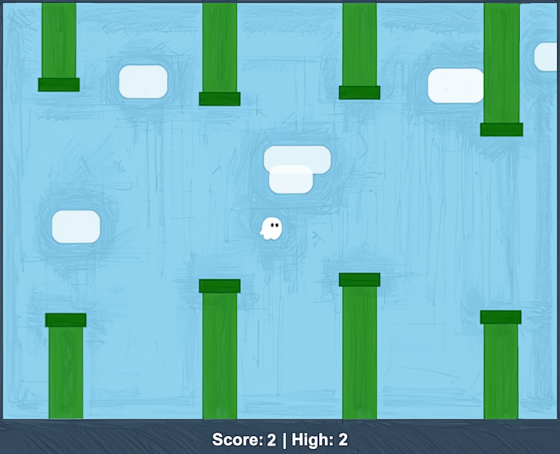

# Flappy Kiro

Initial folder containing support resources for the Flappy Kiro game.

## Example UI



## Running the game

Flappy Kiro is dependency-free with **no build step**. Open `index.html` directly
in a modern browser to play, or serve the folder statically:

```bash
python3 -m http.server 8000   # then visit http://localhost:8000
```

## Development

The game ships no runtime dependencies. The only dev dependency is
[`fast-check`](https://github.com/dubzzz/fast-check) for property-based tests.

```bash
npm install          # install dev dependencies (fast-check)
npm test             # run the full test suite (node --test)
node --test test/physics.test.js   # run a single test file
```

## Project layout

- `src/core/` - pure simulation core (no DOM/Canvas/storage/audio)
- `src/shell/` - impure I/O shell (loop, input, renderer, audio, storage, config)
- `test/` - Node tests (`node:test` + `node:assert`), mirrors source module names
- `assets/` - Game audio and sprites
- `img/` - Screenshots and images
